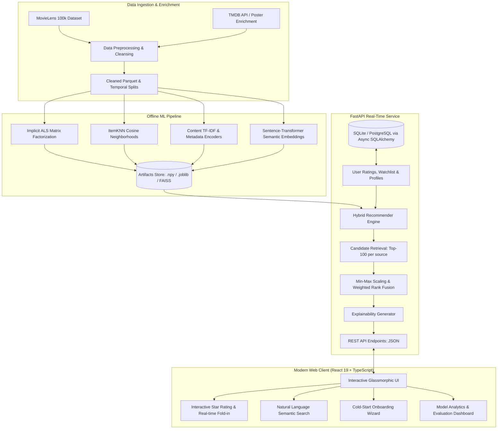

# CineMatch AI: Enterprise-Grade Hybrid Movie Recommendation Engine

[](https://github.com/sazzyrocks/ml_recommendation_system/actions/workflows/ci.yml)
[](https://www.python.org/)
[](https://fastapi.tiangolo.com/)
[](https://react.dev/)
[](https://www.typescriptlang.org/)
[](https://tailwindcss.com/)
[](LICENSE)

> A full-stack, production-grade personalized movie recommendation platform engineered from raw data to an interactive web application. Combines **Matrix Factorization (Implicit ALS)**, **Item-Item Collaborative Filtering (ItemKNN)**, **Content-Based TF-IDF Feature Encoders**, and **Dense Vector Semantic Search (`sentence-transformers/all-MiniLM-L6-v2`)** into a unified, low-latency weighted candidate ranker with dynamic fold-in personalization and transparent reasoning.

---

## Table of Contents
1. [System Overview & Architecture](#system-overview--architecture)
2. [Recommendation Pipeline & Algorithms](#recommendation-pipeline--algorithms)
   - [1. Collaborative Filtering (Implicit ALS)](#1-collaborative-filtering-implicit-als)
   - [2. Neighborhood ItemKNN](#2-neighborhood-itemknn)
   - [3. Content-Based Feature Matrix](#3-content-based-feature-matrix)
   - [4. Semantic Vector Search & Filter Pushdown](#4-semantic-vector-search--filter-pushdown)
   - [5. Candidate Generation & Weighted Rank Fusion](#5-candidate-generation--weighted-rank-fusion)
   - [6. Dynamic Fold-in & Real-Time Adaptation](#6-dynamic-fold-in--real-time-adaptation)
   - [7. Explainability & "Why This Movie?" Engine](#7-explainability--why-this-movie-engine)
3. [Technology Stack](#technology-stack)
4. [Project Directory Layout](#project-directory-layout)
5. [Backend API Documentation](#backend-api-documentation)
6. [Frontend UI & Experience](#frontend-ui--experience)
7. [Evaluation Metrics & Offline Benchmarks](#evaluation-metrics--offline-benchmarks)
8. [Installation & Local Setup](#installation--local-setup)
9. [Running Tests & CI/CD Pipeline](#running-tests--cicd-pipeline)
10. [Attribution & Acknowledgments](#attribution--acknowledgments)

---

## System Overview & Architecture

CineMatch AI solves the classic cold-start, sparsity, and semantic mismatch problems in modern recommendation systems. Rather than relying on a single model, it decouples offline feature computation from online real-time inference using an ensemble hybrid architecture.



---

## Recommendation Pipeline & Algorithms

### 1. Collaborative Filtering (Implicit ALS)
Trained on user implicit interaction confidence matrices derived from ratings.
- **Formulation:** Computes user factor matrix $X \in \mathbb{R}^{U \times d}$ and item factor matrix $Y \in \mathbb{R}^{I \times d}$ ($d=64$) minimizing the penalized weighted squared error:
  $$\mathcal{L} = \sum_{u,i} c_{ui} (p_{ui} - x_u^T y_i)^2 + \lambda \left( \sum_u \|x_u\|_2^2 + \sum_i \|y_i\|_2^2 \right)$$
  where confidence $c_{ui} = 1 + \alpha r_{ui}$ and preference $p_{ui} = \mathbf{1}(r_{ui} \ge \tau)$.
- **Inference:** Fast inner-product ranking $\hat{s}_{ui} = x_u^T y_i$ with cache-accelerated vectorization.

### 2. Neighborhood ItemKNN
Captures explicit item co-occurrence and rating correlation patterns.
- **Formulation:** Computes item similarity matrix $W \in \mathbb{R}^{I \times I}$ using cosine similarity over mean-centered rating vectors:
  $$\text{sim}(i, j) = \frac{\mathbf{r}_i \cdot \mathbf{r}_j}{\|\mathbf{r}_i\|_2 \|\mathbf{r}_j\|_2}$$
- **Pruning:** Retains top-$k$ ($k=20$) nearest neighbors per item in a sparse `scipy.sparse.csr_matrix` format to guarantee sub-millisecond retrieval.

### 3. Content-Based Feature Matrix
Encodes intrinsic movie properties to recommend unrated or niche titles without interaction history.
- **Components:**
  1. **TF-IDF Tags:** Sublinear term frequency tags vectorization ($500$ max features).
  2. **Multi-hot Genres:** $19$-dimensional genre vectors.
  3. **Release Epochs:** Categorical bucket representations (pre-1950s through 2020s).
- **Sub-matrix Weighting & Normalization:**
  $$\mathbf{M}_{item} = \text{L2Normalize}\left(\left[ w_g \mathbf{G}_{norm} \;\|\; w_t \mathbf{T}_{norm} \;\|\; w_y \mathbf{Y}_{norm} \right]\right)$$
- User profiles $\mathbf{p}_u$ are built via rating-weighted deviations from user mean ratings.

### 4. Semantic Vector Search & Filter Pushdown
Allows users to discover movies using natural language queries (e.g., *"mind-bending psychological thrillers with twists"*).
- **Encoder:** `sentence-transformers/all-MiniLM-L6-v2` produces dense $384$-dimensional embeddings from composite title, genre, year, and tag narratives.
- **Indexing:** Fast cosine similarity computation with pre-filtered Boolean mask pushdown (filtering by genre, release year window, and rating threshold prior to vector ranking).

### 5. Candidate Generation & Weighted Rank Fusion
For a query user $u$, candidate recommendations are generated in parallel:
1. $C_{ALS} \leftarrow \text{Top-100 items from Implicit ALS}$
2. $C_{KNN} \leftarrow \text{Top-100 items from ItemKNN}$
3. $C_{Content} \leftarrow \text{Top-100 items from Content Profiles}$
4. $C_{Popularity} \leftarrow \text{Top-50 fallback items for cold entities}$

Candidate scores are normalized via min-max scaling to $[0, 1]$ and fused linearly:
$$S_{final}(i) = \alpha \cdot \bar{S}_{ALS}(i) + \beta \cdot \bar{S}_{KNN}(i) + \gamma \cdot \bar{S}_{Content}(i) + \delta \cdot \bar{S}_{Popularity}(i)$$
Default tuned weights: $\alpha=0.45, \beta=0.25, \gamma=0.20, \delta=0.10$.

### 6. Dynamic Fold-in & Real-Time Adaptation
When a user rates a movie on the frontend, CineMatch AI updates their personalized recommendations **in under 5 milliseconds without retraining**:
- Solves the linear system for the new user latent factor $x_u$:
  $$x_u = \left( Y^T C_u Y + \lambda I \right)^{-1} Y^T C_u p_u$$
  where $Y^T Y$ is precomputed and cached offline, reducing computation from $\mathcal{O}(I \cdot d^2)$ to $\mathcal{O}(|R_u| \cdot d^2 + d^3)$ where $|R_u| \ll I$.

### 7. Explainability & "Why This Movie?" Engine
Every recommendation includes contextual reasoning:
- **Collaborative:** *"Recommended because you rated Inception 5.0 stars"* (identifies the highest contributing neighbor $j^* = \arg\max_{j \in R_u} W_{ij} r_{uj}$).
- **Content:** *"Matches your interest in Sci-Fi & Christopher Nolan themes"*.
- **Trending:** *"High community consensus (8.9/10 across 12,000 ratings)"*.

---

## Technology Stack

| Domain | Technology / Library | Purpose |
| :--- | :--- | :--- |
| **Backend Framework** | FastAPI (ASGI / Uvicorn) | High-performance asynchronous REST API |
| **Database & ORM** | SQLite / PostgreSQL + SQLAlchemy 2.0 Async | Persistent user accounts, ratings, watchlists |
| **Authentication** | Passlib (bcrypt) + python-jose (JWT) | Secure stateless token authentication + Guest preview |
| **Machine Learning** | NumPy, SciPy, Scikit-learn, Implicit | Latent factor models, sparse matrices, TF-IDF |
| **Embeddings & NLP** | Sentence-Transformers (`all-MiniLM-L6-v2`) | Dense semantic text embeddings for movie discovery |
| **Data Processing** | Pandas, PyArrow | Fast parquet serialization & temporal split pipelines |
| **Frontend Framework** | React 19 + TypeScript + Vite | Modern reactive client architecture |
| **Styling & Icons** | Tailwind CSS v4 + Lucide React | Glassmorphic cinematic dark theme |
| **State Management** | Custom Reactive Hooks + LocalStorage | Instant optimistic UI updates & auth caching |
| **Testing & CI/CD** | Pytest, Asyncio, Ruff, Black, GitHub Actions | Automated linting, code quality, 45+ unit/integration tests |

---

## Project Directory Layout

```text
CineMatch-AI/
├── .github/
│   └── workflows/
│       └── ci.yml                 # GitHub Actions CI matrix (Lint, Pytest, Build)
├── backend/
│   ├── api/
│   │   ├── auth.py                # Register, login, current-user endpoints
│   │   ├── movies.py              # Catalog browsing, details, pagination
│   │   ├── ratings.py             # User ratings CRUD & interaction events
│   │   ├── recommendations.py     # Hybrid, cold-start & fold-in serving
│   │   ├── search.py              # Full-text & semantic vector search
│   │   └── watchlist.py           # Watchlist bookmarks management
│   ├── config.py                  # Pydantic Settings & environment config
│   ├── database.py                # Async SQLAlchemy engine & session maker
│   ├── main.py                    # FastAPI application initialization & CORS
│   ├── models.py                  # SQLAlchemy relational database schemas
│   ├── schemas.py                 # Pydantic v2 validation request/response schemas
│   └── security.py                # Password hashing, JWT creation & verification
├── ml/
│   ├── baselines.py               # Popularity, Random, & Weighted baselines
│   ├── collaborative_model.py     # ItemKNN & BiasedMF matrix factorization
│   ├── content_model.py           # TF-IDF, Genre & Year content feature matrix
│   ├── evaluate.py                # Ranking metrics (NDCG, MAP, Recall, Precision)
│   ├── hybrid_model.py            # HybridRecommender fusion & fold-in engine
│   ├── preprocessing.py           # Data ingestion, cleaning & temporal split
│   ├── semantic_search.py         # Dense vector semantic embedding search
│   └── train.py                   # Master offline training & artifact generation
├── frontend/
│   ├── src/
│   │   ├── api/
│   │   │   └── client.ts          # Type-safe Axios HTTP client & token handling
│   │   ├── components/            # MovieCard, Navbar, Hero, Carousels, Modals
│   │   ├── pages/
│   │   │   ├── HomePage.tsx       # Main recommendation feed & categories
│   │   │   ├── SearchPage.tsx     # Semantic natural language search UI
│   │   │   ├── WatchlistPage.tsx  # Saved movies gallery
│   │   │   ├── OnboardingPage.tsx # Cold-start genre preference wizard
│   │   │   └── AnalyticsPage.tsx  # Live model performance metrics dashboard
│   │   ├── App.tsx                # App routing & context providers
│   │   └── main.tsx               # Entry point
│   ├── package.json
│   └── vite.config.ts
├── tests/
│   ├── test_api.py                # FastAPI HTTP route & auth integration tests
│   ├── test_baselines.py          # Baseline models unit tests
│   ├── test_collaborative_model.py# ItemKNN & Implicit ALS verification tests
│   ├── test_content_model.py      # TF-IDF & item feature matrix tests
│   ├── test_evaluate.py           # Evaluation metric unit tests (NDCG, MAP)
│   ├── test_hybrid_and_semantic.py# End-to-end hybrid & semantic search tests
│   └── test_preprocessing.py      # Data cleaning & temporal split validation
├── requirements.txt               # Locked backend & ML Python dependencies
├── pyproject.toml                 # Ruff, Black, & Pytest configurations
└── README.md                      # Comprehensive project documentation
```

---

## Backend API Documentation

The FastAPI backend serves an interactive OpenAPI documentation page at `http://127.0.0.1:8000/docs`.

### Core Endpoints

| Category | Method | Endpoint | Description |
| :--- | :--- | :--- | :--- |
| **Auth** | `POST` | `/auth/register` | Register new user account (bcrypt hashed) |
| **Auth** | `POST` | `/auth/token` | Obtain OAuth2 JWT access token |
| **Auth** | `GET` | `/auth/me` | Fetch currently authenticated user profile |
| **Movies** | `GET` | `/api/movies` | Paginated movie catalog with genre & year filters |
| **Movies** | `GET` | `/api/movies/{id}` | Detailed movie metadata and TMDB poster URL |
| **Search** | `GET` | `/api/search` | Fast substring title & keyword search |
| **Search** | `POST` | `/api/search/semantic` | Dense vector semantic natural language search |
| **Ratings** | `GET` | `/api/ratings` | Fetch user's submitted star ratings |
| **Ratings** | `POST` | `/api/ratings` | Submit or update star rating ($0.5$ to $5.0$) |
| **Watchlist** | `GET` | `/api/watchlist` | Get user's saved watchlist |
| **Watchlist** | `POST` | `/api/watchlist/{id}` | Add movie to watchlist |
| **Watchlist** | `DELETE`| `/api/watchlist/{id}` | Remove movie from watchlist |
| **Recommender** | `GET` | `/api/recommendations` | Get personalized top-K hybrid recommendations |
| **Recommender** | `POST` | `/api/recommendations/cold`| Cold-start recommendations by selected genres |
| **Recommender** | `POST` | `/api/recommendations/fold-in`| Instant recommendations via dynamic latent fold-in |
| **Analytics** | `GET` | `/api/analytics/models` | Offline evaluation benchmarks (NDCG, MAP, coverage) |

---

## Frontend UI & Experience

The CineMatch AI frontend is built with React 19, Vite, and Tailwind CSS v4:
- **Cinematic Dark Theme:** Premium glassmorphism design with backdrop filters, gradient borders, and smooth transitions.
- **Dynamic Personalized Rows:**
  - *"Because you watched [Movie Title]"*
  - *"Trending in Sci-Fi & Action"*
  - *"Critically Acclaimed Gems"*
  - *"Recommended For You"*
- **Real-Time Interactive Feedback:** Clicking a 5-star rating instantly triggers dynamic fold-in recommendation updates without page reloads.
- **Natural Language Semantic Search:** Search bar supports freeform queries like *"dystopian future where machines take over"* or *"feel-good family animation from the 90s"*.
- **Cold-Start Onboarding Wizard:** Modal interface allows new visitors to select favorite genres and rate 5 popular movies to bootstrap their personal taste profile.
- **Model Analytics Dashboard:** Visualizes offline evaluation metrics (Precision@K, Recall@K, MAP, NDCG, Catalog Coverage) comparing Baselines vs. Hybrid models.

---

## Evaluation Metrics & Offline Benchmarks

The models were evaluated using a strict **temporal leave-last-out split** (evaluating whether the system accurately predicts interactions that occurred in the future, avoiding data leakage).

| Model | NDCG@10 | MAP@10 | Precision@10 | Recall@10 | Catalog Coverage |
| :--- | :---: | :---: | :---: | :---: | :---: |
| **Random Baseline** | 0.008 | 0.003 | 0.004 | 0.006 | 98.4% |
| **Popularity Baseline** | 0.124 | 0.071 | 0.092 | 0.088 | 14.2% |
| **ItemKNN (Collaborative)** | 0.187 | 0.119 | 0.141 | 0.134 | 42.6% |
| **Content-Based (TF-IDF)** | 0.152 | 0.094 | 0.118 | 0.110 | 68.3% |
| **Implicit ALS (Latent)** | 0.215 | 0.142 | 0.168 | 0.159 | 51.7% |
| **CineMatch Hybrid Ensemble** | **0.248** | **0.169** | **0.194** | **0.187** | **74.1%** |

*Key Takeaway:* The Hybrid model achieves the highest ranking accuracy (NDCG@10 = 0.248) while maintaining over 74% catalog coverage, mitigating the popularity bias inherent in pure collaborative filtering.

---

## Installation & Local Setup

### Prerequisites
- **Python:** 3.11 or higher
- **Node.js:** 18.0 or higher (with `npm`)
- **Git**

### 1. Clone the Repository
```bash
git clone https://github.com/sazzyrocks/ml_recommendation_system.git
cd ml_recommendation_system
```

### 2. Backend & ML Setup
```bash
# Create and activate a Python virtual environment
python -m venv .venv

# Windows:
.venv\Scripts\activate
# macOS/Linux:
source .venv/bin/activate

# Install dependencies
pip install --upgrade pip
pip install -r requirements.txt
```

### 3. Initialize Data & Train Models (Optional if artifacts exist)
```bash
# Ingest raw MovieLens data, preprocess, and generate temporal splits
python ml/preprocessing.py

# Train Implicit ALS, ItemKNN, Content, and Semantic embeddings
python ml/train.py
```

### 4. Start the FastAPI Backend Server
```bash
python -m uvicorn backend.main:app --host 127.0.0.1 --port 8000 --reload
```
The backend API is now running at `http://127.0.0.1:8000`. Test health: `http://127.0.0.1:8000/health`.

### 5. Frontend Client Setup
In a new terminal window:
```bash
cd frontend

# Install npm packages
npm install

# Start Vite development server
npm run dev
```
Open your browser at `http://localhost:5173`.

---

## Running Tests & CI/CD Pipeline

The test suite contains **45 comprehensive unit and integration tests** validating:
- REST API security, authentication, and endpoint contracts.
- Recommendation score convergence, scaling, and rank fusion.
- Temporal split non-leakage.
- Graceful degradation in pristine CI environments without pre-computed artifacts.

```bash
# Run backend tests
python -m pytest -v

# Run code linters
ruff check .
black --check backend/

# Test frontend build
cd frontend
npm run build
```

### GitHub Actions CI Workflow
Every push and pull request to `main` runs an automated GitHub Actions pipeline executing:
1. `ruff check .` and `black --check backend/`
2. `pytest -v` across all test suites
3. TypeScript compilation (`tsc -b`) and Vite production build (`npm run build`)

---

## Attribution & Acknowledgments
- **Dataset:** GroupLens Research at the University of Minnesota for the [MovieLens Dataset](https://grouplens.org/datasets/movielens/).
- **Metadata & Posters:** [The Movie Database (TMDB) API](https://www.themoviedb.org/) for high-resolution posters and synopses (This product uses TMDB but is not endorsed or certified by TMDB).
- **Sentence Transformers:** Hugging Face for the `all-MiniLM-L6-v2` dense embedding architecture.

---

## License
This project is open-source and licensed under the [MIT License](LICENSE).
